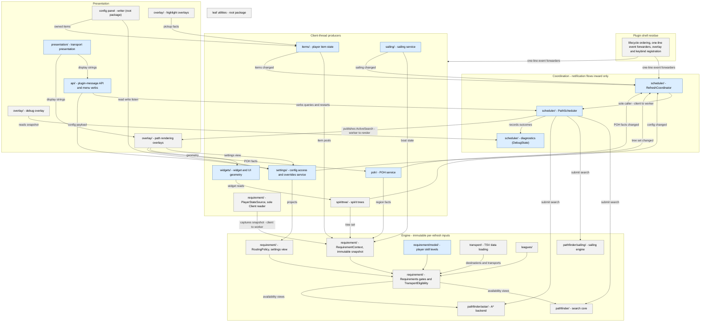

# Target architecture

Where the plugin is headed: a service graph of injected singletons reading
immutable per-refresh snapshots, with the plugin shell thinned to lifecycle
ordering and event forwarding. The current-state inventory lives in
[architecture-survey.md](architecture-survey.md); the order of moves in
[extraction-sequence.md](extraction-sequence.md).

## Layering rules

The target shape is a pragmatic Guice service graph, not a strict layer
cake. Every extraction copies the same rules:

- Services constructor-inject each other's narrow read interfaces. Pulling
  an immutable snapshot is the published-facts mechanism — the
  `RequirementContext` precedent: facts are values, not events.
- Change notification flows inward only. Producers declare "what changed"
  to the refresh coordinator as method calls; the coordinator is the sole
  caller of the path scheduler. No service reaches sideways to trigger a
  sibling's recompute.
- The plugin shell thins to lifecycle ordering, one-line `@Subscribe`
  event forwarders, and overlay/key-listener registration. Menu verbs and
  plugin-message handling delegate to their own services.
- Construction: `@Singleton`/`@Inject` for every plugin-lifetime service —
  Guice fails fast on constructor cycles, which makes the dependency graph
  self-enforcing. `new` for per-refresh objects (`Requirements`,
  `RequirementContext`) and for anything the harnesses subclass —
  `PathfinderConfig` must stay `new`-able for `TestPathfinderConfig` and
  `PluginSettings`. The `SpiritTreePatchState` package-private
  test constructor is the precedent for test-only construction seams.
- Every service and published fact carries its producer-thread and
  consumer-thread pair (client / worker / render) — annotated on the
  diagram below. `PlayerStateSource` stays the only `Client` reader and
  fails loudly off the client thread.

### Rejected alternatives

- **Strict layered decomposition** — every call would route through the
  layer below, so the refresh coordinator ends up brokering all
  cross-service traffic and becomes the next god object. Constructor
  injection of narrow interfaces gives the same isolation without the
  bottleneck.
- **Self-subscribing services** — each service registering directly on the
  RuneLite event bus reintroduces implicit tick ordering; today's handler
  sequence (snapshot capture before invalidation, scheduler calls last) is
  deliberate; smearing it across subscriber registration order would lose
  it.
- **Internal domain-event bus** — an invented publish/subscribe layer adds
  infrastructure nothing else needs and confuses the thread story (which
  thread publishes, which consumes). The client already has an event bus;
  services consuming it through a second bus gain nothing.

## Dependency rule

Declared rule, in the same register the A* backend's `package-info`
already uses:

> Leaf packages — `api/`, `items/`, `leagues/`, `overlay/`, `pathfinder/`,
> `poh/`, `presentation/`, `requirement/`, `sailing/`, `scheduler/`,
> `settings/`, `spirittree/`, `transport/`, `widgets/` — must not depend on
> `ShortestPathPlugin`. Cross-cutting configuration and world-geometry
> access goes through owned services (the settings service, the POH
> service) or leaf utilities. All new coupling arrives through an injected
> seam.

The rule covers the leaf packages only. Top-level files sit outside it —
the `CONFIG_GROUP` read on `ShortestPathConfig` and the shell's own
references are shell-internal surface, not leaf coupling.

On the integrated branch the frozen allowlist is **empty**. Every
pre-existing violation it once recorded retired with its owning
extraction: the `ShortestPathPlugin.class` resource anchors died when the
loader self-anchored, the `override()` reads folded into the settings
service, and the `isInsidePoh`/`POH_*` statics moved into the POH
service. One adjudicated residual remains — `overlay/DebugOverlayPanel`'s
constructor takes `ShortestPathPlugin plugin` only to forward
`super(plugin)`, which RuneLite's `OverlayPanel` base class requires.
Widening the parameter to `net.runelite.client.plugins.Plugin` is a
post-merge cleanup: the file is owned by mid-stack branches, so landing
the two-line fix now would re-diff those pull requests.

Enforcement is `PluginDependencyRuleTest`, a source-scan lint that
lives in the plugin repo's own test tree — `./gradlew test --tests
'*DependencyRule*'` inside `shortest-path/` — alongside the
requirement and A* package-boundary lints, so the seams are enforced
for anyone working in the plugin repo directly, not only through the
composite harness.
Four scans ratchet the boundary:

- the `ShortestPathPlugin.` dotted-token census against the (now empty)
  allowlist — any new leaf-package reference fails the build;
- a comment-aware leaf→plugin *type-reference* scan (imports, parameter
  types, `plugin.` reads) whose named-exception table holds the
  `DebugOverlayPanel` constructor seam — the table fails stale if the
  seam disappears without the entries leaving, so it cannot drift;
- a public-mutable-field scan over every leaf package — the
  `pathfinderConfig.bank` era of public shell state is outlawed;
- a leaf-package census — a new unclassified `shortestpath/*` directory
  fails until it is enrolled.

A second frozen census records leaf-to-leaf import edges with a written
justification each — the designed seams such as `overlay → scheduler`
diagnostics reads and the documented `items ↔ pathfinder` projection.
New sideways coupling fails the build, and a stale edge fails it the same
way. The lint is advisory: the wrapper `test` task runs in neither CI nor
the maintenance-verify chain, and wiring it in is a separate scope
decision.

## Design resolutions

### The gate-verdict contract stays test-only

`Requirements.check(...)` stays package-private and the `RejectionReason`
enum — nineteen constants — remains internal instrumentation. Any
consumer outside tests is an API widening: a real change dressed as a
refactor, which would break the zero-delta attestation every extraction
relies on. The cheapest legitimate future consumer is per-gate rejection
tallies in the debug overlay panel — its own post-milestone pull request,
not bundled into the refactor. Rendering "why can't I use this" tooltips
off the verdicts is rejected outright: the tooltip overlay walks only the
computed path, which contains all-passed transports — the rejected ones
are exactly what it never sees, so the feature needs rejected-transport
rendering and hit-testing first. Exposing verdicts over the plugin-message
API is parked inside the protocol-design work rather than decided here.

### `BankVisitState` replaces the positional `boolean` at seams

The banked/unbanked `boolean` that crosses package boundaries becomes an
enum at API surfaces — `BankVisitState.CARRIED` and
`BankVisitState.BANKED` — at the availability views
(`getTransportsPacked`, `getUsableTeleports`, `getTransportAvailability`),
`TransportEligibility.usable`, `PathStep.isBankVisited`, the visited-store
and node-store signatures, and the search-loop reads. Internals stay
primitive: `state & 1`, the `FLAG_BANK_VISITED` byte and the twin visited
arrays are storage encoding, not readability problems. There is no
generalized flags container — league, free-to-play and sailing status are
per-refresh account facts (snapshot inputs), not mid-search state
transitions; the bank-visit edge is the only confirmed second dimension.
The change landed as a standalone mechanical pull request (upstream #732)
ahead of the API/presentation and scheduler work — it crossed the engine,
the middleware, the shell and the harness twins, so it could not nest
inside a single subsystem extraction without re-diffing the same
signatures twice.

### Coupling direction is declared and ratcheted

Resolved by the dependency rule above: the rule is declared, the formerly
frozen violations emptied out as their owning extractions landed — the
`override()` reads folded into the settings service, the
`isInsidePoh`/`POH_*` references into the POH service, and the resource
anchors disappeared when the loader landed self-anchored — and the lint
keeps the set non-growing.

## Diagram

Two graphs: the **integrated state** — the extraction stack accumulated on
the `1.22.0` integration branch, wired in the injected-service shape — and
the **target state** it converges on. Node labels name the packages as
they exist on the branch. Upstream's own tip still carries the
pre-extraction shape the survey's census describes; the backward
`plugin.*`/`ShortestPathPlugin.` reads it relied on are gone from the
stack — the one dashed edge that remains is the adjudicated constructor
seam below. Edge labels that cross threads carry the producer-thread to
consumer-thread pair.

```mermaid
flowchart TD
    subgraph RL["RuneLite host"]
        Client["Client - mutable game state"]
        Events["event bus"]
        ConfigMgr["ConfigManager"]
    end

    subgraph Shell["Plugin shell residue - root package"]
        Plugin["ShortestPathPlugin - lifecycle ordering, one-line event forwarders, overlay and key-listener registration"]
        Panel["config panel - ShortestPathPanel, RestrictionListPanel, TransportFamilyCard"]
        CfgDecl["ShortestPathConfig - @ConfigItem declarations"]
    end

    Util["leaf utilities - root-package helpers"]

    subgraph Prod["Client-thread producers"]
        Cfg["settings/ - Settings service, EffectiveConfig"]
        PSS["requirement/ - PlayerStateSource, sole Client reader"]
        Items["items/ - ItemStateService"]
        Trees["spirittree/ - SpiritTreeService"]
        POH["poh/ - PohService"]
        Sail["sailing/ - SailingService"]
        Geo["widgets/ - WidgetGeometry, GameWidgets"]
    end

    subgraph Coord["Coordination - notification flows inward only"]
        RCO["scheduler/ - RefreshCoordinator"]
        Sched["scheduler/ - PathScheduler"]
        Diag["scheduler/ - DebugState"]
    end

    subgraph Engine["Engine - immutable per-refresh inputs"]
        RC["requirement/ - RequirementContext snapshot"]
        RP["requirement/ - RoutingPolicy settings view"]
        Gates["requirement/ - Requirements gates and TransportEligibility"]
        Skills["requirement/model/ - SkillLevels"]
        TSV["transport/ - ResourceLoader"]
        Parser["transport/parser/ - TSV grammar"]
        Leagues["leagues/"]
        PF["pathfinder/ - search core and PathfinderConfig"]
        SailEng["pathfinder/sailing/ - sailing search"]
        AStar["pathfinder/astar/ - A* backend"]
    end

    subgraph Present["Presentation"]
        API["api/ - PluginMessageHandler, PluginMessageTargets, MenuVerbs"]
        TPres["presentation/ - PathAnnotator, BankPickupRequirements"]
        PathOv["overlay/ - path rendering overlays"]
        HighOv["overlay/ - highlight overlays"]
        DbgOv["overlay/ - DebugOverlayPanel"]
    end

    Events --> Plugin
    Plugin --> Client
    Plugin --> ConfigMgr
    Plugin -->|one-line event forwarders| Prod
    Plugin -->|forwards client events| RCO
    Plugin --> Util
    Panel -->|read write listen| Cfg
    Panel -->|owned items| Items
    PSS -->|captures snapshot - client to worker| RC
    Items -->|item pools| RC
    Trees -->|tree set| RC
    POH -->|region facts| RC
    Sail -->|boat state| RC
    Cfg -->|projects| RP
    Cfg -->|config changed| RCO
    Items -->|items changed| RCO
    Trees -->|tree set changed| RCO
    POH -->|POH facts changed| RCO
    Sail -->|sailing changed| RCO
    Trees -->|menu scrape| Geo
    RCO -->|sole caller - client to worker| Sched
    Sched -->|submit search| PF
    Sched -->|submit search| SailEng
    Sched -->|submit search| AStar
    Sched -->|records outcomes| Diag
    RC --> Gates
    RP --> Gates
    Skills --> Gates
    Parser --> TSV
    TSV -->|destinations and transports| Gates
    Leagues --> Gates
    Gates -->|availability views| PF
    Gates -->|availability views| AStar
    API -->|queries restarts and menu verbs| Sched
    API -->|config payload| Cfg
    TPres -->|display strings| API
    PathOv -->|annotated display| TPres
    HighOv -->|pickup facts| Items
    Sched -->|publishes ActiveSearch and PathRenderState - worker to render| PathOv
    PathOv -->|settings view| Cfg
    PathOv -->|geometry| Geo
    PathOv -->|POH facts| POH
    DbgOv -->|reads snapshot| Diag
    DbgOv -.->|ctor seam - OverlayPanel base requires the plugin instance| Plugin

    classDef shell fill:#f8e3e3,stroke:#a33,color:#000
    class Plugin shell
```

The target state below is what the integrated graph already realizes:
producers watch game state on the client thread and publish immutable
facts; the coordinator hears "what changed" and is the scheduler's only
caller; the engine consumes snapshots on the worker thread; presentation
reads published handles on the render thread. The remaining distance is
the `DebugOverlayPanel` constructor seam and the registered upstream
follow-ups — not missing structure.

## Extraction status

Each subsystem's disposition, kept in three distinct states: **stack** —
carried by an open upstream draft pull request; **on `1.22.0`** —
accumulated on the integration branch; **merged upstream** — landed in
the upstream repository itself. Nothing has merged upstream: every stack
pull request is open — nearly all are drafts — so that column reads
pending throughout.

| Subsystem | Home on the integrated tip | Stack PR | On `1.22.0` | Merged upstream |
|-----------|----------------------------|----------|-------------|-----------------|
| Requirement middleware | `requirement/` + `requirement/model/` | #707, #708, #709, #710 | yes | pending |
| Banked/unbanked domain type | `pathfinder/BankVisitState` | #732 | yes | pending |
| Config access and settings | `settings/` | #716 | yes | pending |
| Player item state | `items/` | #721 | yes | pending |
| Spirit trees | `spirittree/` | #722 | yes | pending |
| POH | `poh/` | #726 | yes | pending |
| Path scheduler + diagnostics | `scheduler/` | #733 | yes | pending |
| Refresh and invalidation coordination | `scheduler/RefreshCoordinator` | #734 | yes | pending |
| Sailing service | `sailing/` | #747 | yes | pending |
| Widget and UI geometry | `widgets/` | #775 | yes | pending |
| Plugin-message API + menu verbs | `api/` | #776 | yes | pending |
| Transport presentation | `presentation/` | #776 | yes | pending |
| Path rendering overlays | `overlay/` | #777 | yes | pending |
| Highlight overlays | `overlay/` | #778 | yes | pending |
| Player skill levels | `requirement/model/SkillLevels` | #792 | yes | pending |
| TSV data loading | `transport/ResourceLoader` | #793 | yes | pending |
| Widget scraping | `widgets/GameWidgets` | #794 | yes | pending |
| Config panel | `ShortestPathPanel`, `RestrictionListPanel`, `TransportFamilyCard` (root) | #711 | yes | pending |
| Pathfinder search core | `pathfinder/` | — | yes | deferred — coherent unit, existing upstream code |
| A* backend | `pathfinder/astar/` | — | yes | deferred — coherent unit, existing upstream code |
| Leagues | `leagues/` | — | yes | deferred — coherent unit, existing upstream code |
| Transport TSV parser | `transport/parser/` | — | yes | deferred — coherent unit, wrapped by the loader |
| Leaf utilities | root-package helpers | — | yes | leaf listing — no extraction needed |
| Plugin shell | `ShortestPathPlugin` (root) | — | yes | residual — lifecycle and forwarding only |

A combined both-states overview is deliberately omitted: compressing both
graphs into one stays legible only under roughly twenty nodes, and the
honest count is well above it.
